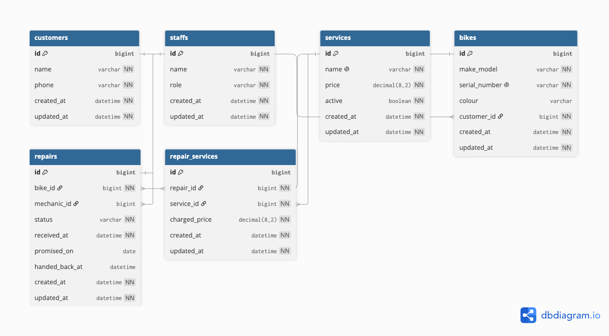

# Wheelhouse — Domain Model

## Diagram



## DBML

The image above was produced from this code in [dbdiagram.io](https://dbdiagram.io).
It compiles as it stands and describes the schema built in Lab 5 (see `db/schema.rb`):
six tables, `bigint` primary and reference columns, `decimal(8,2)` money, and the
unique indexes the database enforces. The relationships are drawn from the `_id`
columns. The database does **not** yet enforce them with foreign-key constraints —
those, and the Rails associations that use them, are added in Lab 7.

```dbml
Table customers {
  id bigint [primary key]
  name varchar [not null]
  phone varchar [not null]
  created_at datetime [not null]
  updated_at datetime [not null]
}

Table staffs {
  id bigint [primary key]
  name varchar [not null]
  role varchar [not null]
  created_at datetime [not null]
  updated_at datetime [not null]
}

Table services {
  id bigint [primary key]
  name varchar [not null, unique]
  price decimal(8,2) [not null]
  active boolean [not null, default: true]
  created_at datetime [not null]
  updated_at datetime [not null]
}

Table bikes {
  id bigint [primary key]
  make_model varchar [not null]
  serial_number varchar [not null, unique]
  colour varchar
  customer_id bigint [not null]
  created_at datetime [not null]
  updated_at datetime [not null]

  indexes {
    customer_id
  }
}

Table repairs {
  id bigint [primary key]
  bike_id bigint [not null]
  mechanic_id bigint
  status varchar [not null, default: 'Received']
  received_at datetime [not null]
  promised_on date
  handed_back_at datetime
  created_at datetime [not null]
  updated_at datetime [not null]

  indexes {
    bike_id
    mechanic_id
  }
}

Table repair_services {
  id bigint [primary key]
  repair_id bigint [not null]
  service_id bigint [not null]
  charged_price decimal(8,2) [not null]
  created_at datetime [not null]
  updated_at datetime [not null]

  indexes {
    repair_id
    service_id
  }
}

// Relationships carried by the _id columns.
// Drawn here; enforced by foreign-key constraints in Lab 7.
Ref: bikes.customer_id > customers.id
Ref: repairs.bike_id > bikes.id
Ref: repairs.mechanic_id > staffs.id
Ref: repair_services.repair_id > repairs.id
Ref: repair_services.service_id > services.id
```

## Relationships

The `_id` columns carry these relationships. They are plain columns today; the
foreign-key constraints that enforce them, and the Rails associations that use them,
are added in Lab 7.

- A customer owns many bikes; a bike has one current owner (`bikes.customer_id`).
  Ownership can change, so repair history hangs off the bike, not the customer.
- A bike has many repairs over its life; a repair is for exactly one bike (`repairs.bike_id`).
- A repair has many priced line items; each line item belongs to one repair
  (`repair_services.repair_id`).
- A service can appear on many repairs; a line item points to one service
  (`repair_services.service_id`). `repair_services` is the many-to-many join between
  repairs and services.
- A staff member handles many repairs; a repair has one responsible mechanic
  (`repairs.mechanic_id`, nullable — a repair can arrive before a mechanic is assigned).

## Lifecycle of a repair

`repairs.status` moves through these states, and the column defaults to the first one,
`Received`:

**Received → Assessed → Awaiting approval → Approved / Declined → In progress → Ready → Collected**

Allowed transitions:

- **Received → Assessed** — a mechanic inspects the bike and assesses the work.
- **Assessed → In progress** — a minor job that needs no approval starts directly.
- **Assessed → Awaiting approval** — the job needs the customer's yes first.
- **Awaiting approval → Approved** — the customer agrees to the estimate.
- **Awaiting approval → Declined** — the customer refuses.
- **Approved → In progress** — work begins once approved.
- **In progress → Ready** — the work is finished.
- **Ready → Collected** — the owner picks the bike up.
- **Declined → Collected** — the owner picks the bike up as it arrived.

Transitions that are **not** allowed:

- **Received → In progress** — work cannot start before the bike is assessed.
- **Received → Ready / Received → Collected** — a bike cannot be ready or leave
  before any assessment or decision.
- **Awaiting approval → In progress** — no work while the customer's yes is still
  pending; the owner is explicit that we wait before touching the bike.
- **Declined → In progress** — declined work is never carried out.
- **Ready → In progress** — a finished repair is not reopened; a new problem is a
  new repair, which keeps the bike's history correct.
- **Collected → any state** — once collected, the repair is closed.

## Changes since Lab 3

Every difference between the diagram submitted in Lab 3 and the schema built today:

- **`photos` table removed** — arrival photos arrive in Lab 9 with their own table;
  this lab excludes them.
- **`repairs.diagnosis` removed** — the written diagnosis arrives in Lab 9 with its
  own table.
- **`repairs.promised_for` renamed to `promised_on`** — a column that holds a day uses
  the `_on` suffix (a datetime instant would use `_at`).
- **`repairs.handed_back_at` added** (datetime, nullable) — the instant the bike was
  handed back; it tells a repair still in the shop apart from one already collected. A
  repair that has not been handed back has no value here.
- **Table `staff` renamed to `staffs`** — Rails pluralization, so the `Staff` model
  finds its table with no explicit `table_name`.
- **`price` and `charged_price` typed as `decimal(8,2)`** — money is never a float;
  precision and scale are declared.
- **`repairs.status` given a default of `Received`** — a repair inserted with no state
  starts in the first state of the lifecycle.
- **All `id` and `_id` columns are `bigint`** (the Rails 8 default) rather than
  `integer`; each `_id` is the same type as the `id` it holds.
- **`created_at` / `updated_at` added to every table** — Rails timestamps.
- **Relationships shown but not enforced** — the diagram draws the relationships the
  `_id` columns carry, but the database does not enforce them with foreign-key
  constraints today; those constraints and the Rails associations are added in Lab 7.

## Entities and the stories that require them

| Entity | Story that requires it |
|---|---|
| customers | Story 1 — register the owner's name and phone |
| bikes | Story 1 & 10 — identify a bike by serial and carry its history |
| staffs | Story 5 & 6 — the mechanic responsible for a repair |
| repairs | Stories 5–8 & 12 — the repair record and its promised date |
| services | Story 7 & 14 — the priced wall list, shown publicly |
| repair_services | Story 7, 9 & 13 — the services on a repair, at the price charged |

(The `photos` row is gone: that table is deferred to Lab 9.)

## Two decisions

### The thing and the copy of the thing

Every physical bike is its own row in `bikes`, identified by `serial_number`, and
every repair links to that specific bike through `repairs.bike_id`. That is what
prevents the March mix-up: two blue Trek Marlins are two rows with two serial
numbers, each with its own owner and its own repair history, so the shop hands
back the right one. A single `bikes` table with a `make_model` and a `quantity`
column ("2 × Trek Marlin") could count how many Marlins are on the rack, but it
could not answer which physical bike belongs to which customer, nor hold a repair
history for one of them and not the other.

### Derived, or stored?

**Deliberately not stored (derived):** the total cost of a repair. There is no
`total` column on `repairs`; the total is the sum of `charged_price` across that
repair's `repair_services` rows. Storing it would risk a total that silently
disagrees with its own line items.

**Looks derivable but stored anyway:** `repair_services.charged_price`. It looks
like it could be read from `services.price`, but it is stored as a snapshot taken
when the service is added to the repair. If it were not stored, recomputing an old
repair's cost from the current `services.price` would change last year's invoices
every January when the wall list goes up — exactly what the owner says must never
happen. Storing it also lets a mechanic charge a regular less than the list
without altering the catalogue.
