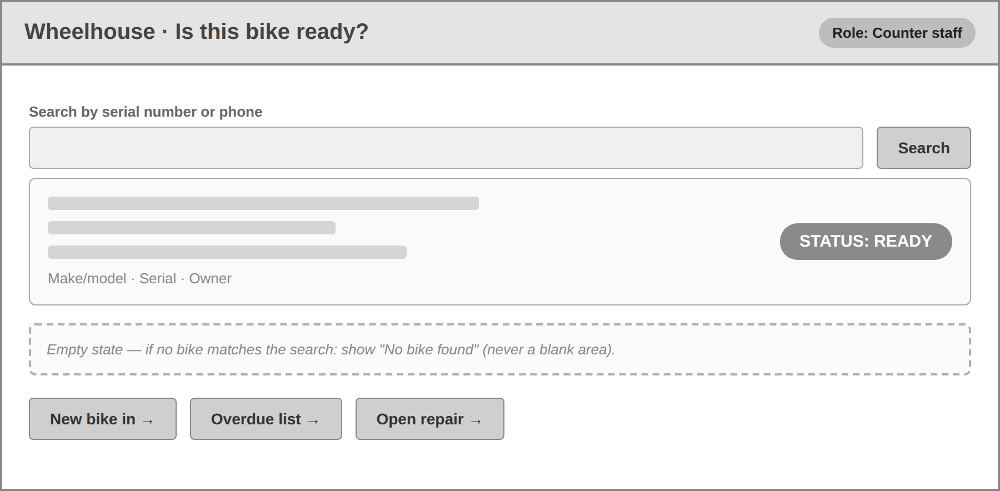
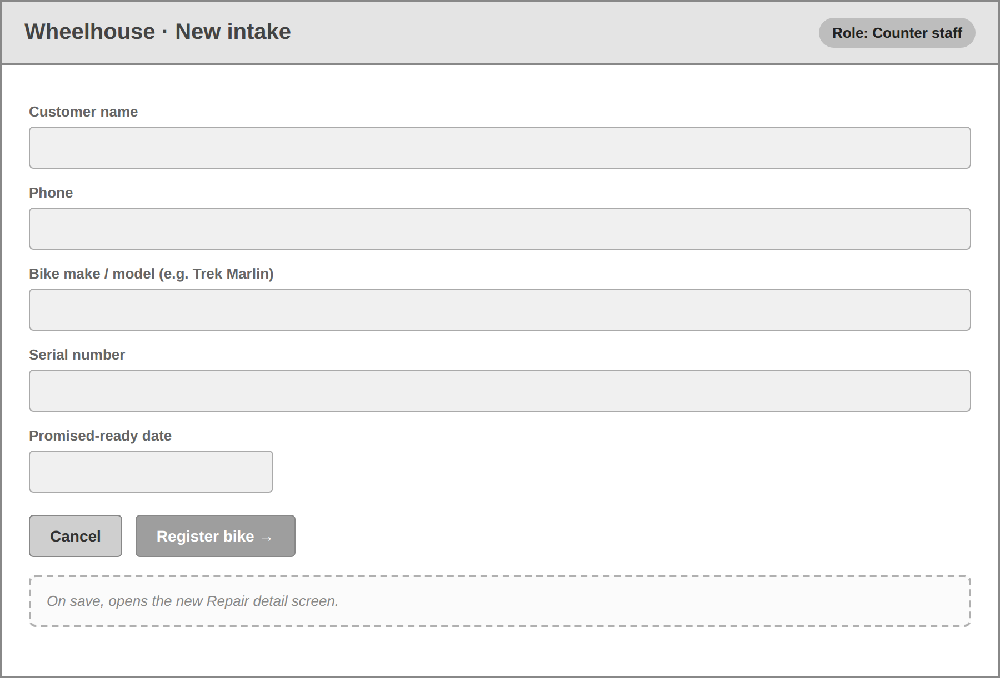
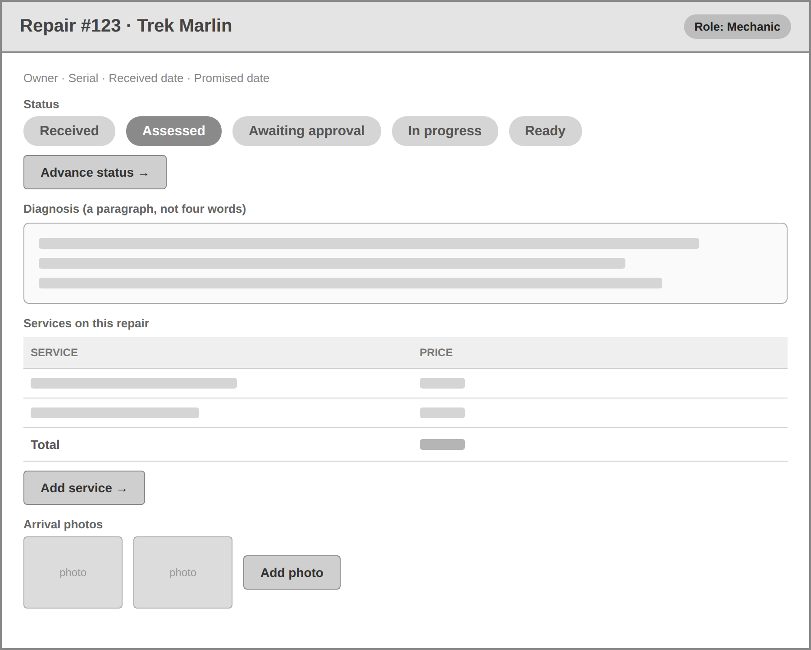
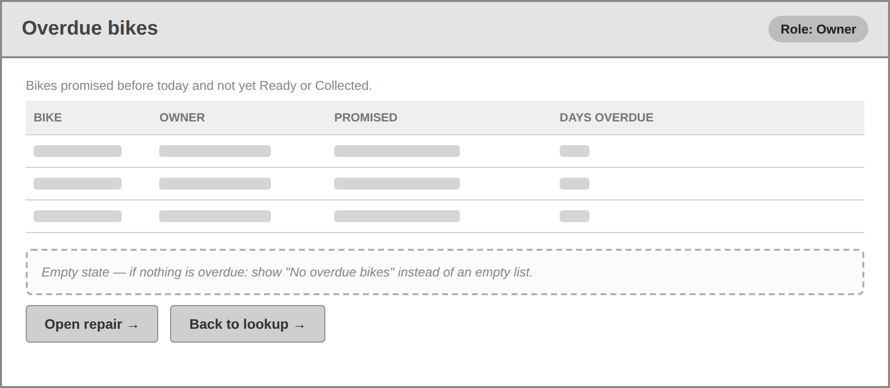
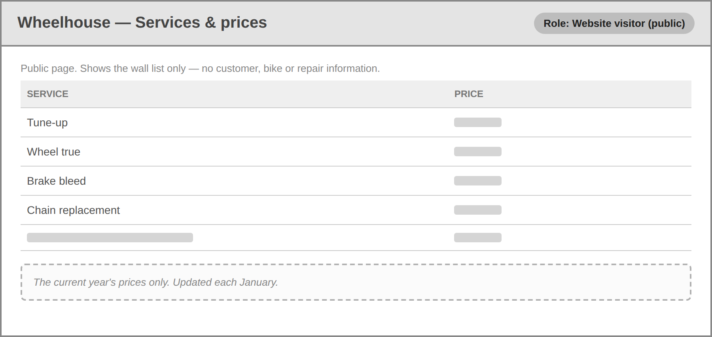
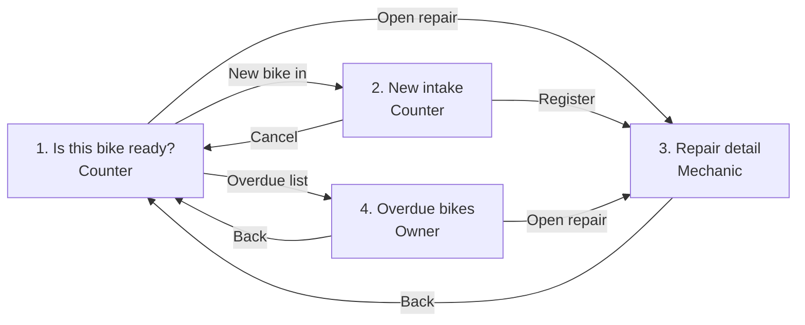

# Wheelhouse — Wireframes

Low-fidelity, grey boxes. Colour, typography and finish are not the point. Each
screen names the role that looks at it.

## Screens

### 1. Is this bike ready? — Counter staff

This is the screen used at the counter to answer the owner's question: is a given
bike ready. The counter searches by serial number or phone and reads the bike's
status without walking to the workshop. If no bike matches, the screen shows
"No bike found" rather than a blank area.

### 2. New intake — Counter staff

Registers an arriving bike: owner name and phone, make/model, serial number, and
the promised-ready date. On save it opens the new repair.

### 3. Repair detail — Mechanic

Where the mechanic works: advances the status, writes the diagnosis, adds the
priced services, and attaches arrival photos.

### 4. Overdue bikes — Owner

Lists bikes whose promised date has passed and that are not yet Ready or Collected,
with how many days each is overdue. If nothing is overdue it says so.

### 5. Services & prices — Website visitor (public)

The public page. Shows the wall list of services and their current prices only —
no customer, bike or repair information appears.

## Navigation graph

The four staff screens form the internal app. Every screen is reachable from the
counter lookup, and no screen is a dead end.

Screen 5 (Services & prices) is a **separate one-page public website**, reached by
its own URL. By the owner's rule that nothing else is public, it links to no other
screen, so it sits outside the staff navigation above rather than as a dead end
inside it.
